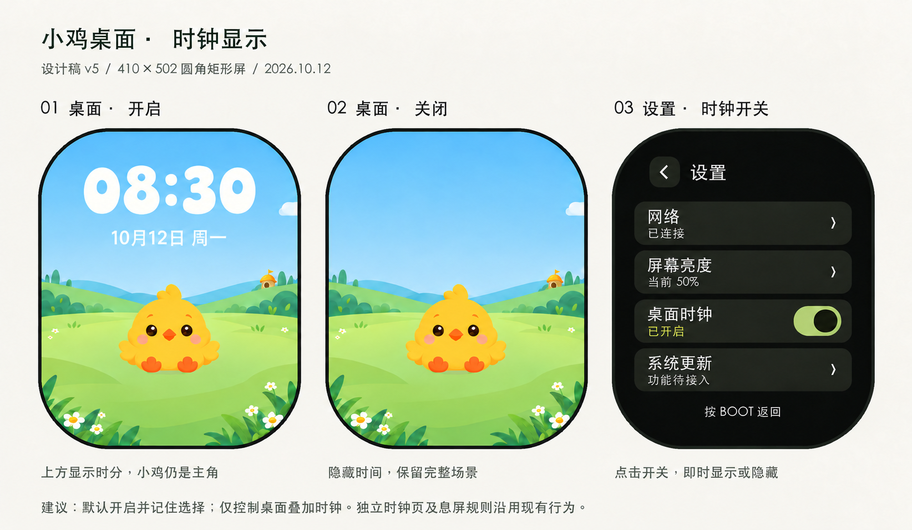
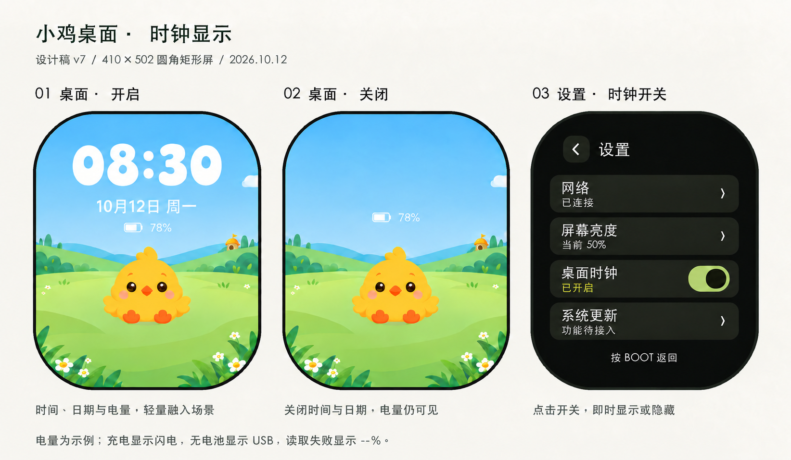
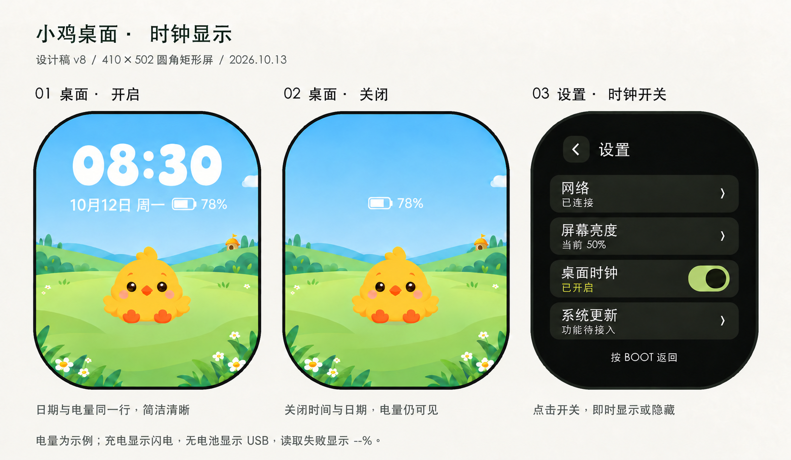

# 小鸡桌面时钟设计

日期：2026-10-12。状态：v5已实现（待真机验收）。

用户已确认需求：小鸡桌面上方支持显示时钟，设置页面支持开关。实现采用首次默认开启、成功保存后重启恢复；构建、刷写与验收结果见下方实现记录及产品记录。

当前采用版本：**v5**。2026-10-12用户明确选择v5，采用大号卡通数字、中文日期与星期（如「10月12日 周一」），时间与日期均为纯色暖白，无阴影、描边及底板。v6英文日期仅保留为历史探索，不作为当前实现依据。

## 布局与交互

- 桌面上方居中显示24小时制时分，不显示秒数；2026-10-12按用户反馈取消深色底板，已确认v5采用直接叠加在天空中的纯色柔白卡通圆润数字，无底板、无阴影，视觉字号参考约68px，上方居中。具体字号以实现时的410×502布局检查为准。沿用当前草地场景和角色素材。
- 设置首页增加「桌面时钟」，四项一屏展示；行高68px、间距10px，开关完整触摸范围76×48px。当前固件仍是三项首页。
- 拟定点击后立即显示或隐藏桌面时间，关闭状态显示「已关闭」，开关圆点在左侧；开启显示「已开启」，圆点在右侧。建议默认开启、保存后重启保留。
- 此开关仅控制桌面叠加时间；不改变独立时钟页、PWR/BOOT导航和自动息屏。替代PU-005中不提供时间开关的设计限制，范围明确为桌面时钟。
- 时间来自现有系统/RTC；显示无可用时间时使用「--:--」，不展示虚构时间。后台校时等待或失败不阻塞宠物动画；有有效RTC时间则继续显示。
- 保存失败拟提示「未保存，请重试」，不得声称重启保留成功；正式实现需覆盖失败反馈、按下状态、重启及实体按键检查。无需键盘；长提示换行，不侵入开关。

## 校验范围

v1设计图按410×502、111px圆角参考模型遮罩呈现，主要卡片、返回按钮、开关完整边界通过8px内缩模型检查。后续生成式视觉稿仅做圆角遮罩视觉检查，不等同于精确几何校验。111px不是面板实测半径，尚未真机验收。图中时间、联网和亮度均为设计示例。

## v2视觉调整

用户要求桌面时钟与背景融合、避免突兀。新版去除独立卡片，让天空连续；柔白数字轻微缩小，弱阴影只用于辅助可读性。替代v1深色时间卡片方向，保留v1历史图。新版为生成式视觉稿，旧版的坐标检查不代表新版通过完整几何校验；需实现时逐项检查文字及阴影边界，真机验证白云经过、明暗场景及低亮度可读性。正常/无时间/校时等待失败/保存失败及实体按键规则沿用本页设计；本次无键盘变化。

## v3数字调整

2026-10-12用户要求数字更大、采用活泼卡通字形。新版建议约68px视觉字号，饱满圆润、略带自然变化的数字，暖白色配轻微天空蓝阴影；保留上方居中、无底板方向。字体与大小为视觉稿参考，正式实现需确认字体授权、数字资源预算、00:00/11:11/23:59/--:--完整字形及阴影安全区，并验证白云经过和低亮度可读性。设计稿未实现，v1/v2历史图保留。

## v4日期补充

2026-10-12用户要求在时间下方增加一行小字日期。设计采用「10月12日 周一」示例，月日与星期一行居中，圆润常规字形、约22px视觉字号，沿用暖白及轻微蓝色阴影，与时间约14px间距。开启桌面时钟时显示时间与日期，关闭时一并隐藏。日期与时间取同一北京时间来源，跨午夜同步更新。待实现时检查12月31日等日期、星期、无有效时间（日期不展示虚构值）、白云经过及低亮度可读性，并核验完整文字和阴影安全区；不开键盘，实体按键及等待/失败规则沿用。v4为设计稿，未实现。

## v5无阴影预览

2026-10-12用户要求去掉时钟与日期阴影查看效果。v5时间与日期均采用纯色暖白，无阴影、描边或底板；保留v4字号、卡通数字、日期位置与间距。此稿最初用于对比预览；2026-10-12用户已确认采用v5，待实现；v4保留。需实现时核验完整字形圆角安全区和白云经过、明暗场景、低亮度下的可读性，正常/等待/失败/无有效时间、长日期与实体按键规则沿用，键盘不涉及。

## v6英文日期

2026-10-12用户要求日期及星期使用英文，以简洁为目的。历史v6探索稿采用「Oct 12 · Mon」格式：英文月份三字母缩写、日（不补零）、居中点分隔、星期三字母缩写；保持小字号约22px、纯色暖白、无阴影，位置和日期间距沿用v5。英文日期替代v4/v5中文日期，历史预览保留。日期仍按北京时间计算，不因英文呈现改变时区。正式实现需覆盖全部月份/星期组合、双位日期、跨月/跨年/午夜、无有效时间，以及文字完整安全区与白云/低亮度可读性；设置开关及按键规则沿用。本稿未实现。

## 最终选择（2026-10-12）

用户明确要求使用v5。替代v6英文日期方向，恢复中文月日与星期；v5视觉稿作为后续实现基准。默认开启与重启保留仍为此前建议，不因选择视觉稿而描述为已实现或已验收。本次仅确认设计并同步记录，未修改或烧录固件。

## 实现记录（2026-10-12）

v5已实现：圆润卡通时间、中文日期、纯色暖白无阴影；设置四项首页及桌面时钟开关。默认开启，成功保存后即时显隐与重启恢复，失败保持原状态并可重试。参考造型使用本地圆润数字字体子集，实际字形以[LVGL布局预览](previews/home-clock-layout-implemented.png)为准（单色背景仅用于布局检查）；[设置页实际渲染](previews/home-clock-settings-implemented.png)。完整验证与行为见[显示说明](../../firmware/WATCH_DISPLAY.md)。构建通过，真机验收待完成；历史设计阶段描述保留。

## v7桌面电量设计（未实现）

2026-10-12用户要求桌面增加电量并更新设计图。在已实现v5的时间和中文日期下方，新增居中小号电池图标与百分比，参考约20px文字和10px间距，纯色暖白、无底板、无阴影。示例78%不是设备实测值。

设计建议：电量作为独立桌面状态常显，不随「桌面时钟」开关隐藏；时间/日期关闭时，电量保留原位置。此开关联动方式为建议，待确认。充电时在百分比旁增加闪电，充满显示100%及充满标识；无电池且USB供电显示USB，无电池且无USB显示「无电池」，读取失败/数值无效显示电池图标与--%，不显示虚构百分比。电量来自现有AXP2101读取机制，约5秒刷新、有变化才重绘，避免阻塞动画；默认沿用独立时钟页的数据规则，具体等待/驱动失败状态待实现。

新增内容位于屏幕中上部天空，设计预览使用圆角遮罩且视觉未贴近四角；生成式图不等于精确坐标/触摸验收。实施时核验0%/100%/USB/无电池/--%及充电文本宽度、完整安全区、低亮度和白云经过，不遮宠物头部；电量不增加点击操作和键盘，BOOT/PWR及息屏沿用。v5固件及其验收状态保持，电量本次仅更新设计稿，未修改或刷写固件。

## v8日期与电量同一行（2026-10-13，未实现）

用户要求电量与日期同一行，替代v7第三行布局。时间下方一行居中显示「10月12日 周一  [电池图标] 78%」，日期和电量同基线，参考20–22px字号，整体不超过320px宽；沿用无阴影、无底板暖白样式。示例百分比非实测。关闭时间与日期后电量独立常显仍为建议（待确认），不擅自更改已实现开关语义。

待实现需覆盖最长中文日期、100%、充电/充满、USB、无电池、--%等组合，必要时精简状态文案以保证整行安全区和可读性，不以缩至难读小字塞入；生成式圆角预览不等于精确边界验收。BOOT/PWR、等待/失败、时钟开关和键盘规则沿用v7说明，本次未修改或烧录固件。
