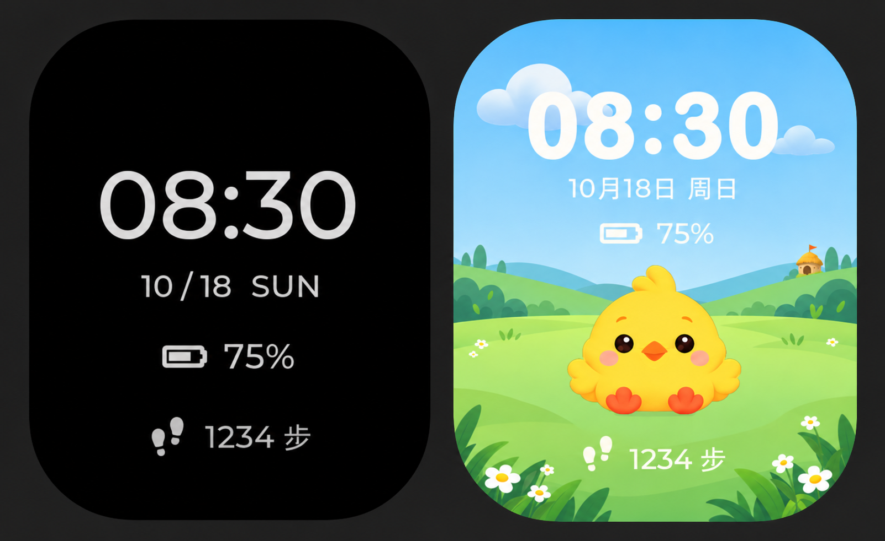
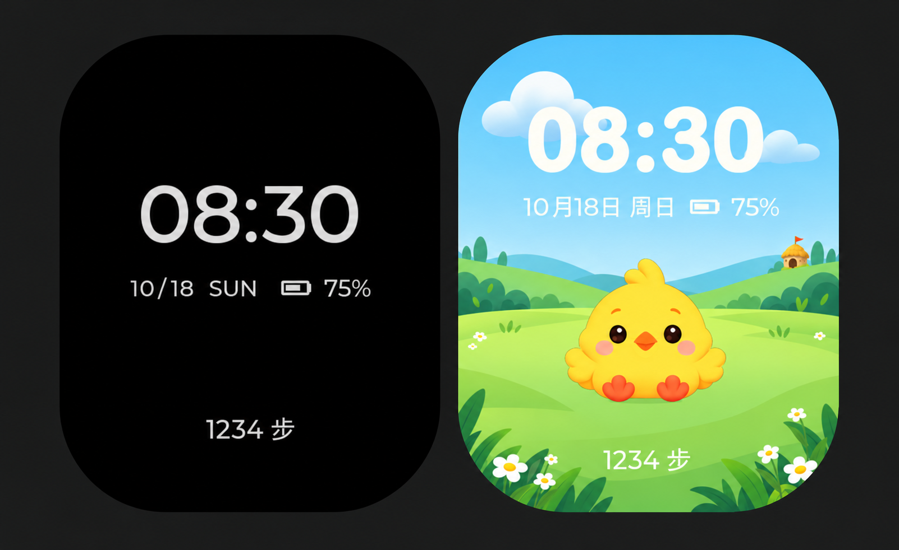
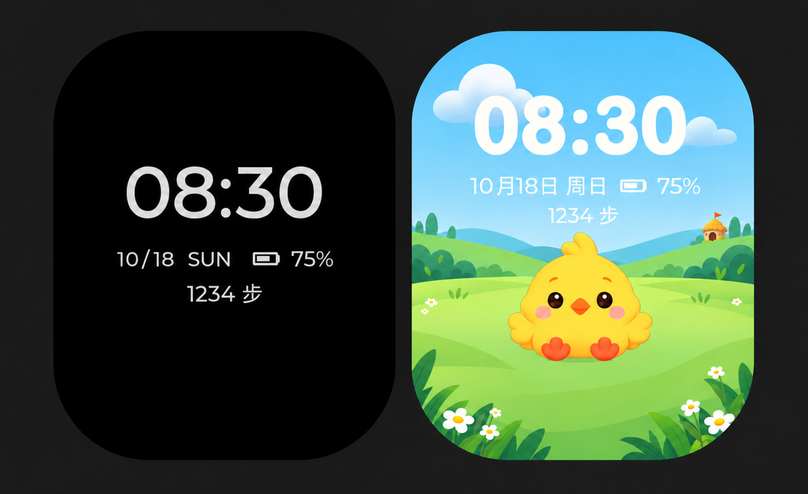
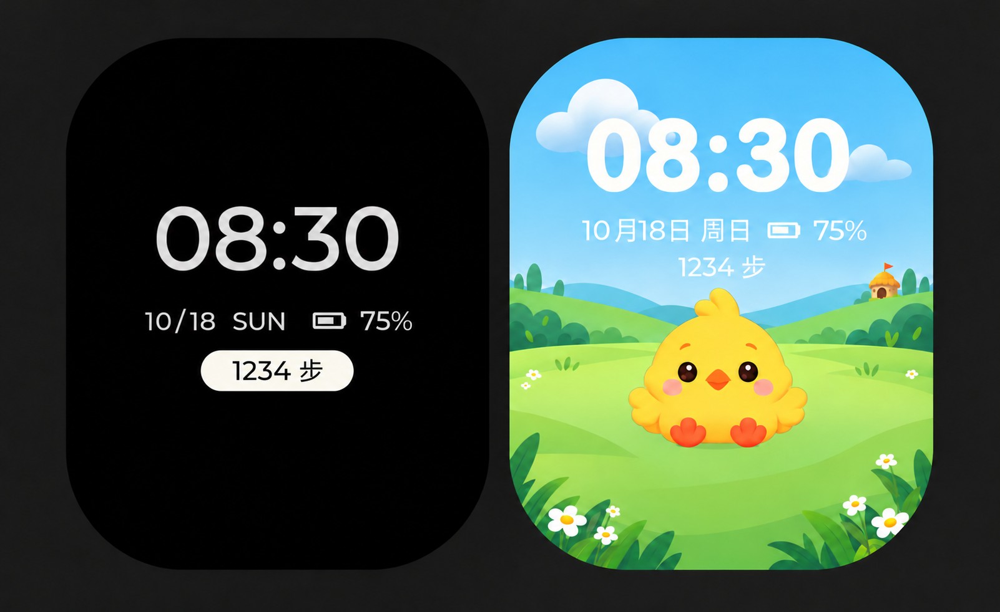
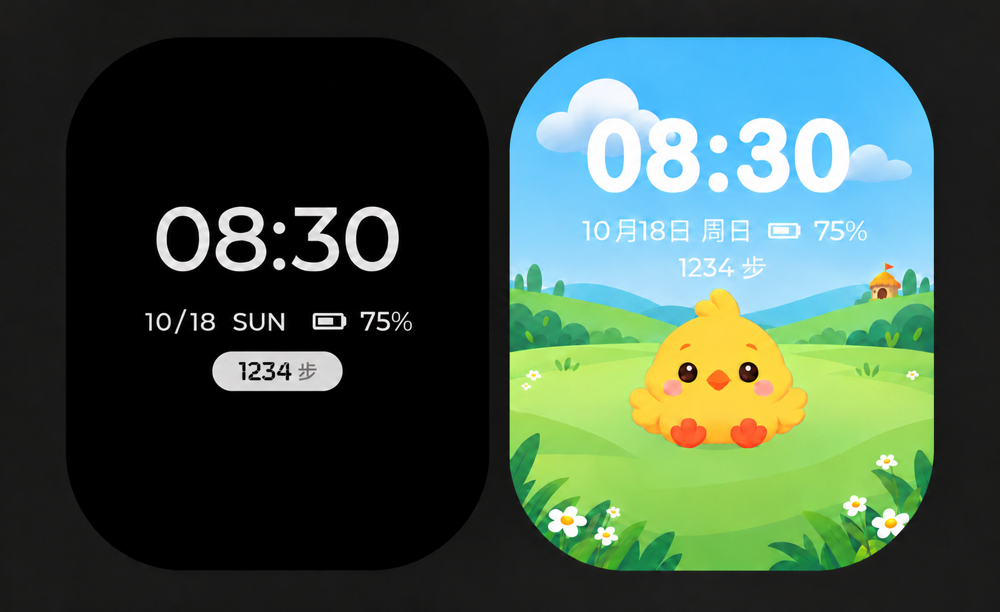
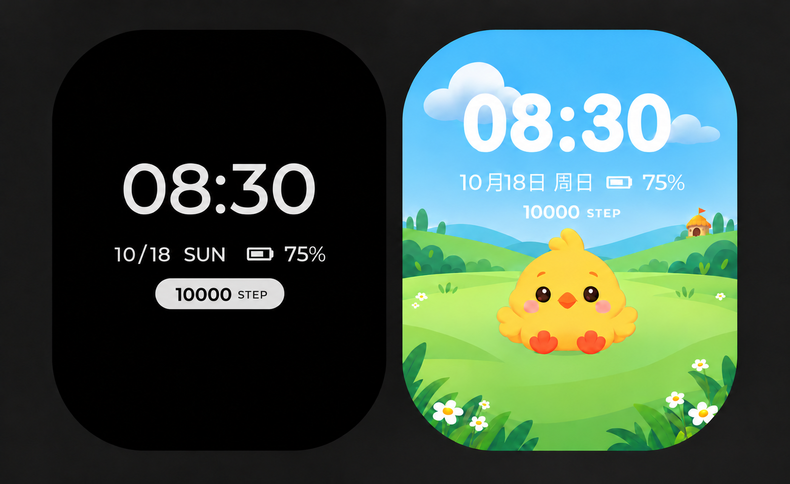
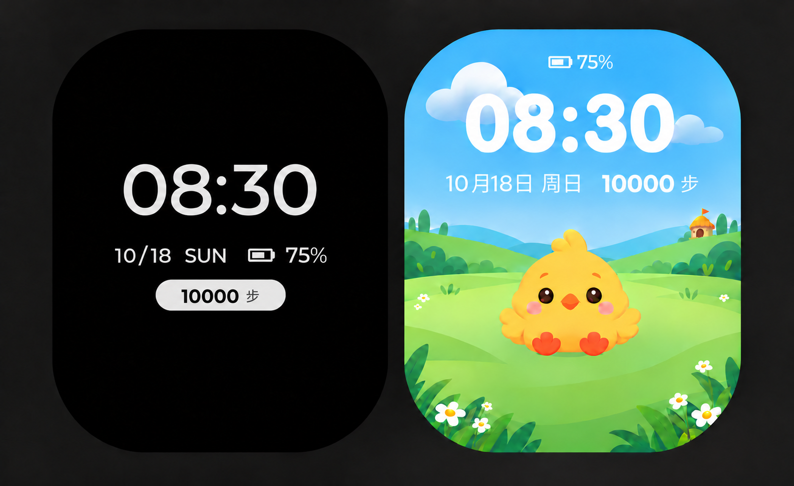
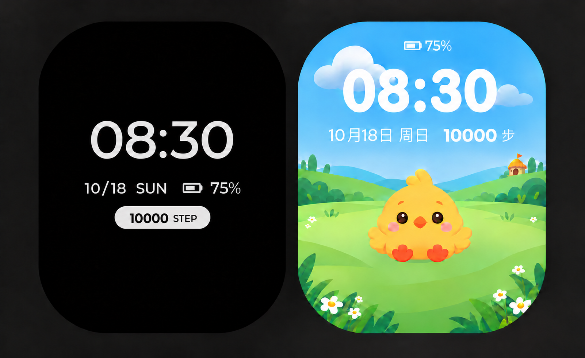

# 电池与步数显示设计稿 v1

日期：2026-10-18。状态：设计稿，未实现、待用户确认。保留既有统一规范，不替代已确认规则。

极简时钟：沿用时间、日期、电量层级，电量下方增加灰色脚印与“1234 步”。小鸡桌面：沿用时间、中文日期、场景和宠物，在日期下新增暖白电量行，底部步数配脚印。电量75%、步数1234仅为示例。

本次无新增入口、按钮或触摸目标；BOOT/PWR、触摸返回、超时、桌面时钟开关与保存规则均不作变更。状态信息的显隐及数据源仍应在实现时依据现有规则核对。本图不表示硬件计步、电量精度或充电状态已验收。

已目视检查两表盘完整圆角遮罩与文字留白。AI效果图不是精确410×502坐标交付；落地需按111px参考圆角+8px内缩验证完整字形和图标，复核最长数字、0步、100%、充电、电量读取等待/失败、计步失败、低亮度及真实场景。不得用示例值掩盖等待或失败。新布局不改变实体按键规则，无新增等待操作或存储行为。

生成方式：内置 imagegen，使用用户两张截图作为编辑目标。
提示词核心：保留两张参考表盘风格、时间日期与宠物构图；左图电量下加脚印和1234步，右图日期下加电池和75%、底部步数加脚印；无卡片、无阴影，保持圆角安全留白。完整提示词参数以本聊天工具调用为准。

## v2 · 2026-10-18

用户认为v1过满，否定首版。v2将日期与小号电量合并一行，移除独立电量行与脚印图标，步数以底部单行文字呈现。状态为设计稿、待确认，未改固件。仍须按统一规范做落地坐标、长文字、失败及真机验证。

内置imagegen提示词核心：忠实保留原图，缩小次要状态信息；日期与电池百分比合行，底部仅1234步，无脚印、卡片、阴影，扩大留白。

## v3 · 2026-10-18

用户要求制作日期下方步数方案。保留v2时间、日期及电池位置，步数缩小并移至日期下方居中，小鸡主屏天空区域承载信息，底部草地留空。设计稿未实现、待视觉确认；不改变入口、实体按键、超时或保存行为。示例数据不代表设备读数。目视检查圆角和留白，精确410×502坐标、最长数字/失败文案、低亮度与真机可读性仍待验证。

生成方式：内置imagegen编辑v2。提示词核心：仅移除底部步数并恢复背景；两屏步数改为日期电量行下方的小号居中文字；保留所有其他位置、字体、场景和角色，无脚印、底板和阴影。

## v4 · 2026-10-18

按用户要求，左侧步数采用白底黑字胶囊，保留日期下方位置；右侧沿用v3。胶囊仅信息展示，不新增按钮语义、入口或按键行为。设计稿未实现、待确认，不改变已确认规范。圆角及留白目视检查完成；最长数字、异常状态、低亮度、精确坐标与真机验收待完成。

内置imagegen编辑v3；提示词核心：只将左侧1234步改为居中暖白底、黑字的小胶囊，全圆角、适量内边距，无图标、描边、阴影，其他元素保持。

## v5 · 2026-10-18

根据用户对v4的反馈，缩窄左侧步数胶囊，减小字号，单位进一步缩小并弱化，背景改浅灰以降低视觉重量。右侧保持。仅设计稿、待确认，未改固件，不新增点击行为或改变规范。已目视检查圆角和留白，精确尺寸、最长数字及失败文案、低亮度和真机验证待完成。图示底色有轻微AI明暗，不能视为精确纯色实现。

内置imagegen编辑v4。提示词核心：仅优化左侧步数胶囊为更紧凑的小号浅灰状态标签，黑色数字、较小灰色单位，圆角，无新增图标或阴影，其他元素保留。

## v6 · 2026-10-18

用户要求步数字体更有数字感，左侧胶囊内1234改为电子表数码管风格等宽字形，单位保持小号普通中文，其余沿用v5。设计稿未实现、待确认，不改变交互或统一规范。AI效果图不等于最终字体资源，实际段间隙、数字0–9、最长数字、异常文字、低亮度与真机可读性待验证；圆角与留白仅目视检查。

内置imagegen编辑v5。提示词核心：只将左侧胶囊内1234替换为清晰等宽七段数码管字形，黑色数字、小号灰色单位，保持胶囊和其他内容，无发光、描边或未亮段。

## v7–v8 · 2026-10-18

用户澄清字形方向为加粗硬朗、非数码管，单位可用STEP，并询问10000步显示。v7窄粗运动字体被反馈突兀；v8改正常宽度中等加粗无衬线数字，小号STEP，两屏统一步数字体层级。左侧胶囊按五位数适度加宽，右侧仍无底板，完整显示10000而不缩写。内容适配为设计提案，并非已实现排版规则。

设计稿待确认，未改固件、入口、按键、超时或保存行为，不替代已确认规范。图示圆角和五位数目视检查完成；实际410×502字号和留白、最长数字、异常文字、场景对比度及真机小字可读性待验证。图中STEP仍是演示文案选择。

内置imagegen以v5为参考编辑；提示词核心：五位10000 STEP，数字正常宽度中等加粗、轮廓利落，避免数码管和极窄运动字体，STEP小号次要，左侧轻量胶囊、右侧白色无底板，保留时间电量与场景，协调全部信息层级。

## v9–v10 · 2026-10-18

v9试作顶部10000 STEP、日期电量同排。用户随后提出电量顶部、步数替换原电量位置，并授权选择单位；助手推荐v10顶部电量，日期与10000步同排，两表盘统一中文“步”，以匹配中文日期并节省宽度。推荐方案待用户确认，未实现、未修改固件及按键/超时/保存行为，不替代已确认规范。

图示圆角与五位数字目视检查完成，不等于精确410×502安全区或真机验收。最长日期/步数、100%/充电/读取失败/等待、低亮度与字体资源落地待验证。

内置imagegen生成v9并以v8制作电量顶部探索，再编辑中文单位。最终提示词核心：顶部小号电池和75%，时间不变，日期右侧10000步同排，正常宽度适度加粗数字、小号中文单位，保留小鸡与场景及左侧胶囊，不新增阴影或装饰。

## v11 · 2026-10-18

按用户明确要求，左侧胶囊使用10000 STEP，右侧保持10000步及顶部电量布局。按最新稿调整；“第3个方案”的编号指代尚未核实，本次不声明历史版本已获最终确认。仅设计稿、待确认，未改固件与交互。圆角和五位数留白目视检查，最长文字、异常、实际字号和真机待验证。

内置imagegen编辑v10，提示词：仅将左侧胶囊内中文步替换为小号STEP，居中整组，其他布局保留。

## 2026-10-18 用户确认附图后实现

用户要求按本轮附图把步数做上去、两个界面都显示电量；以附图对应的v11样式为依据落地。实际控件实现与异常/长数字降级见[计步说明](../../firmware/STEPS.md)，[主界面预览](../../assets/previews/watch-status-20261018/implemented/home.png)、[黑底时钟预览](../../assets/previews/watch-status-20261018/implemented/standby.png)。预览来自实际固件场景/状态组件离屏渲染，数据模拟；参考圆角模型不等同于实测面板。已实现待真机验收，未刷机。

2026-10-18第二轮按原稿比例校准：修正上一版日期/电量偏小、胶囊偏大和主屏信息行偏低。最新实际控件预览为[主屏](../../assets/previews/watch-status-20261018/strict/home.png)、[待机](../../assets/previews/watch-status-20261018/strict/standby.png)；双窗口模拟器入口`lvgl-simulator/tools/run_status_preview.sh`。比例校准不代表字形与参考位图逐像素相同；真机待验收。

2026-10-18用户后续明确要求（PU-084，替代此前相应规则）：主屏桌面时钟开关同时控制时间、日期和步数；关闭后仅保留电量，开启后三项一起恢复。黑底待机时钟及后台计步/保存策略不受此开关影响。源码已实现并经主机测试，v1.1.1候选固件待真机验收。
