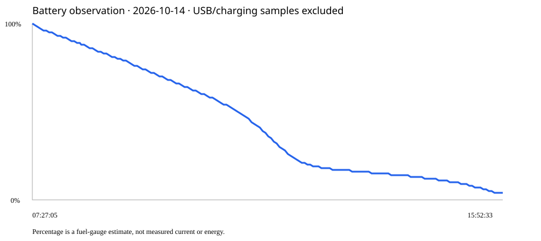

# 2026-10-14 电池观察结果

来源：本机私有CSV `firmware/backup/battery_day_20261014.csv`，174条，序号0～173连续。用户报告剩余3%后授权导出，未刷写固件。完整导出结束标记通过。

用户日常使用的主要放电区间：07:27:05～15:52:33，约8.42小时，电量100%→4%，电压4068→3463mV。平均下降约11.4个百分点/小时，只是该区间估计表读数变化，非电流或能量，不外推精确满电续航。

全部174条中167条采样时黑屏；174条Wi-Fi开关开启。采样比例不能当亮屏时间比例；Wi-Fi开启不等于一直连接。主要放电区间内取得IP标记为5/170条，说明应进一步检查离线重连/扫描行为，而不能假设全天Wi-Fi稳定连接。

19→20与172→173运行时间回零，表明发生重启；前者约08:19，原因无法仅凭电池日志确定，后者为本次导出重启。序号连续，没有发现按块覆盖造成的缺口。两段内部采样约180秒。

15:52:33记录4%、3463mV，15:55:34记录3%、3608mV且USB/充电标记开启，导出重启后15:58:05为5%、3648mV。后两条属于补电/电压回升，不能计为纯放电区间。早期调试记录07:16:19为95%，与之后100%的正式使用分开。

初步结论：当前配置下即使采样多为黑屏，仍存在明显基础耗电；不能单凭此日志定位到屏幕、Wi-Fi或某外设，也不能证明轻睡眠实际进入。省电配置标记代表允许，不是睡眠占比实测。此轮没有优化前对照，不能给每项优化收益。

下一步优先核查Wi-Fi无IP期间的重连频率、实际轻睡眠与唤醒、屏幕零亮度时驱动状态；再做等时的保持Wi-Fi/停Wi-Fi对比，并评估屏幕真正休眠与外设待机。继续保留用户按需配置的产品决策，不擅自改变默认Wi-Fi策略。电流/容量未知，不报告mAh、平均电流或提升小时数。

